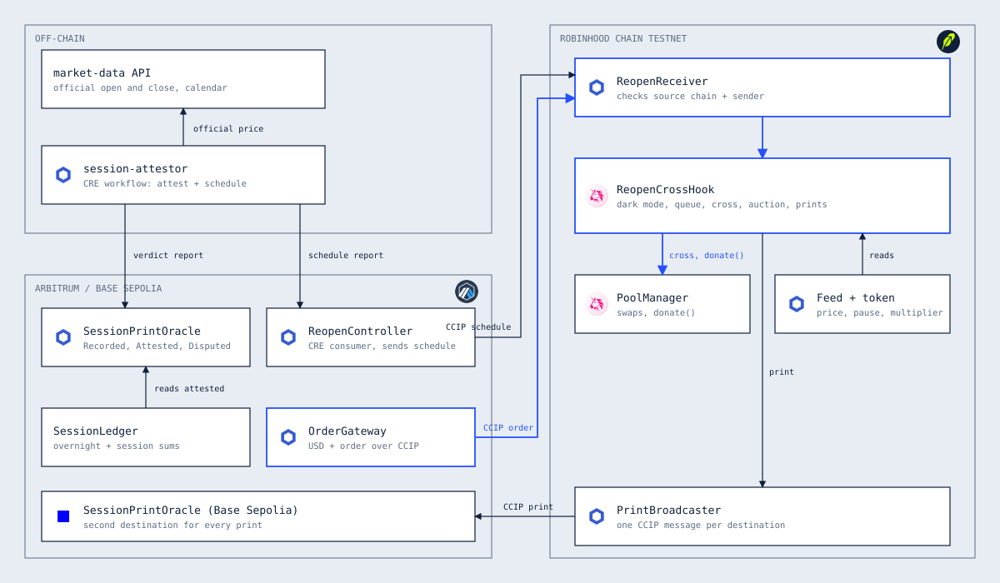
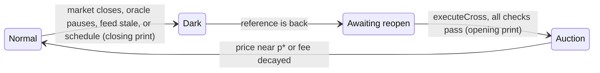
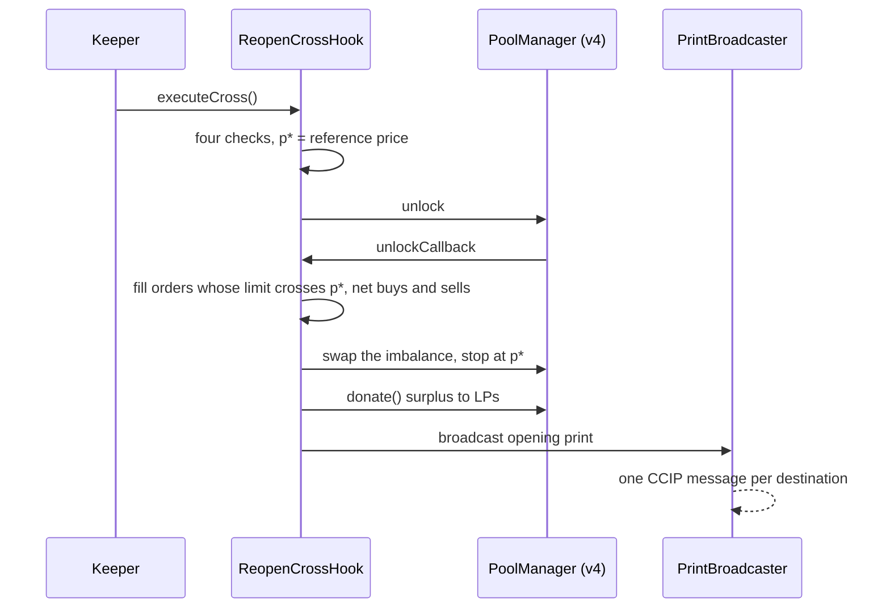
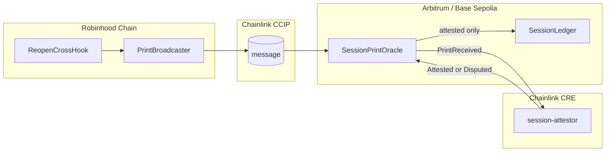

<p align="center"></p>

# Corvex

**Monday's open, cleared once. Uniswap v4 Hooks.**

Corvex is a Uniswap v4 hook for tokenized-stock pools. While a stock's reference price is dark (weekend, split pause, halt) it queues large trades. When the reference comes back it clears the whole queue in one uniform-price cross, donates the surplus to LPs, and records a split-safe **Session Print**. A Chainlink CRE workflow checks each print against the official exchange open or close, and CCIP carries it to other chains.

The hook is a Uniswap v4 hook with a dynamic fee, an async queue, a uniform-price cross, `donate()` to LPs, and a decaying-fee gap auction (modelled on Uniswap's StablePair hook).

## Proof it runs

| What | Where |
| --- | --- |
| Contract tests | `forge test` in [contracts](contracts): 104 tests, including fuzzing of cross settlement across four pool orientations |
| CRE workflow logic | `npm test` in [cre/session-attestor](cre/session-attestor): 13 tests |
| Full workflow through the UI | `npm run test:e2e` in [web](web): queue, cross, print, attest, withdraw on a live local chain |
| One weekend, on-chain | [LocalScenario.s.sol](contracts/script/LocalScenario.s.sol) sends every step as a real transaction to a local chain |
| Three-pool replay | [Replay.t.sol](contracts/test/Replay.t.sol), results below |

Run the whole system on your machine in two minutes: [Quick start](#quick-start).

### Replay: what LPs lose

The same 6% gap at the open, measured in USDG on a 400,000 USDG pool (1,000 TSLA at $200), marked at the reopen price. Source: [Replay.t.sol](contracts/test/Replay.t.sol).

| Scenario | No hook | Fee-only hook | Corvex |
| --- | --- | --- | --- |
| 6% gap, no queued orders (gap auction only) | -157.47 | -48.25 | -2.93 |
| Weekend flow, then a 6% gap | -115.75 | +385.47 | -0.0000000000000003 |

Corvex returns 98% of the loss in the auction-only case and all of it when the queue clears at the reopen. The fee-only column is an illustrative baseline that charges half of the pool's dislocation from the reference. These are Foundry runs on mocks with a competitive-arbitrage model. The fork replay of the real June 26, 2026 weekend needs a Robinhood Chain mainnet RPC.

## Track checklist

| Track | Requirement | How Corvex meets it | Evidence |
| --- | --- | --- | --- |
| Uniswap | v4 hook with an async queue | Out-of-band exact-input swaps are taken as ERC-6909 claims and queued, up to 50 per pool | [`_queueFromSwap`](contracts/src/ReopenCrossHook.sol) |
| Uniswap | Uniform-price cross | `executeCross` nets buys and sells, trades only the imbalance against the pool, never past the cross price | [`_settleCross`](contracts/src/ReopenCrossHook.sol), [Cross.t.sol](contracts/test/Cross.t.sol) |
| Uniswap | `donate()` to LPs | Everything above liabilities after the cross is donated | [`_donateSurplus`](contracts/src/ReopenCrossHook.sol) |
| Uniswap | Dynamic-fee auction | Fee starts at 5%, falls each block, applies only toward the cross price | [`_auctionFee`](contracts/src/ReopenCrossHook.sol), [`test_auctionFeeDecaysOnlyTowardCrossPrice`](contracts/test/Cross.t.sol) |
| Uniswap | Session Print at each open and close | Closing print on entering dark, opening print on the cross | [`_recordPrint`](contracts/src/ReopenCrossHook.sol) |
| Chainlink CCIP | State change in our contracts over CCIP | Prints reach two oracles, schedules reach the hook, orders reach the queue | [PrintBroadcaster](contracts/src/ccip/PrintBroadcaster.sol), [SessionPrintOracle](contracts/src/ccip/SessionPrintOracle.sol), [ReopenReceiver](contracts/src/ccip/ReopenReceiver.sol), [Ccip.t.sol](contracts/test/Ccip.t.sol) |
| Chainlink CCIP | Programmable token transfer | `OrderGateway` sends USD and an order in one message | [OrderGateway](contracts/src/ccip/OrderGateway.sol), [`test_crossChainOrderQueuesAndFills`](contracts/test/Ccip.t.sol) |
| Chainlink CRE | Blockchain plus external API | The workflow fetches the official open and close, and the exchange calendar | [main.ts](cre/session-attestor/main.ts) |
| Chainlink CRE | Output is used | Only attested prints reach `SessionLedger`; schedules drive early dark mode | [SessionLedger](contracts/src/consumers/SessionLedger.sol), [`test_scheduleTravelsFromControllerToHook`](contracts/test/Ccip.t.sol) |

## How it works



### The pool's modes



- **Normal.** Swaps use the normal fee.
- **Dark.** A swap executes if its post-trade price stays within 2% of the last reference. A larger exact-input swap is taken as a claim and queued. An `afterSwap` check guarantees no swap leaves the band, whatever the estimate said.
- **Awaiting reopen.** Every swap reverts until the cross runs, so nothing fills at a stale or wrong price.
- **Auction.** Swaps toward the cross price pay a fee that starts at 5% and falls every block. Swaps the other way pay the normal fee.

The cross needs the market in regular session, the token oracle unpaused, a fresh feed, a multiplier that matches an announced split, and a price within 20% of the pre-dark price. The split case is tested end to end in [`test_splitMismatchWaitsForUnpauseAndMultiplier`](contracts/test/Cross.t.sol): the oracle is paused, then unpaused with the multiplier stale, then updated with the feed behind, and the cross only runs at $212 with multiplier 2.0, never at $106.

### The cross



Fillers pay p*. The pool leg usually costs less, and the difference is the surplus donated to LPs. If the pool cannot supply a full fill at p*, the short side is scaled down and the rest refunded. Fills and refunds are held as ERC-6909 claims and paid out with `withdraw`.

### Session Prints



A print stores the token price and the multiplier, so a split day never shows a fake 50% move. `SessionLedger` books overnight (open minus prior close) and session (close minus open) in token terms for the same reason.

## Uniswap v4 integration

Where to look to verify it. All paths are in [contracts/src](contracts/src).

| Piece | Where |
| --- | --- |
| Hook permissions and address bits | [ReopenCrossHook.sol:257](contracts/src/ReopenCrossHook.sol#L257), mined by [HookDeployer.sol](contracts/script/HookDeployer.sol) |
| `beforeInitialize` (dynamic-fee check) | [ReopenCrossHook.sol:264](contracts/src/ReopenCrossHook.sol#L264) |
| `beforeSwap`: dark-mode queue via `BeforeSwapDelta`, dynamic fee override | [ReopenCrossHook.sol:276](contracts/src/ReopenCrossHook.sol#L276) |
| `afterSwap` | [ReopenCrossHook.sol:301](contracts/src/ReopenCrossHook.sol#L301) |
| Queued orders held as claims | `_queueFromSwap` [:456](contracts/src/ReopenCrossHook.sol#L456), `queueExternal` [:514](contracts/src/ReopenCrossHook.sol#L514) |
| The cross: `executeCross`, `unlockCallback`, `_settleCross` | [:601](contracts/src/ReopenCrossHook.sol#L601), [:634](contracts/src/ReopenCrossHook.sol#L634), [:673](contracts/src/ReopenCrossHook.sol#L673) |
| `donate()` of the surplus to LPs | `_donateSurplus` [:814](contracts/src/ReopenCrossHook.sol#L814) |
| Session Print recorded on every close and open | `_recordPrint` [:873](contracts/src/ReopenCrossHook.sol#L873) |

Developer feedback for the Uniswap team is in [FEEDBACK.md](FEEDBACK.md).

## Cross-chain orders and fill delivery

A buyer on Arbitrum or Base sends USD and an order to Robinhood Chain in one transaction through [OrderGateway](contracts/src/ccip/OrderGateway.sol). [ReopenReceiver](contracts/src/ccip/ReopenReceiver.sol#L119) queues it in the hook. Each cross-chain user owns their orders through a small [FillVault](contracts/src/ccip/FillVault.sol), so the hook's credits stay attributable. After the cross, anyone can call [`deliver`](contracts/src/ccip/ReopenReceiver.sol#L169) to send the fills back to the user's source chain over CCIP. If a token has no lane back, the fill stays as a claim on Robinhood Chain rather than getting stuck. The user can also take fills in place with `withdrawHere` or cancel an open order with `cancelFor`.

## Chainlink integration

| Piece | What it does | Code |
| --- | --- | --- |
| CCIP, print broadcast | Sends each print to every registered oracle. One failing destination never blocks the others, and a failed broadcast never blocks the hook | [PrintBroadcaster](contracts/src/ccip/PrintBroadcaster.sol), [`_broadcast`](contracts/src/ReopenCrossHook.sol) |
| CCIP, schedule | CRE report to the controller, then CCIP to the receiver, which can move the pool to dark early and never out | [ReopenController](contracts/src/ccip/ReopenController.sol), [ReopenReceiver](contracts/src/ccip/ReopenReceiver.sol) |
| CCIP, orders | Token plus order data. If an order cannot be queued it becomes a refundable claim instead of reverting | [OrderGateway](contracts/src/ccip/OrderGateway.sol), [`_onOrder`](contracts/src/ccip/ReopenReceiver.sol) |
| CRE, attest | EVM log trigger on `PrintReceived`. Each DON node fetches the official price, the nodes agree on the median, and the workflow compares it split-adjusted | [`onPrintReceived`](cre/session-attestor/main.ts), [logic.ts](cre/session-attestor/logic.ts) |
| CRE, schedule | Cron every five minutes reads the calendar and delivers new schedules once | [`onScheduleTick`](cre/session-attestor/main.ts) |
| Consumers | Forwarder check, workflow-owner pinning, per-chain and per-print replay protection | [ReceiverTemplate](contracts/src/cre/ReceiverTemplate.sol), [SessionPrintOracle](contracts/src/ccip/SessionPrintOracle.sol) |
| Data Feeds | The token-price feed sets p*, staleness and plausibility | [`_feedPrice`](contracts/src/ReopenCrossHook.sol) |

Every CCIP receiver checks the source chain selector and sender address. CRE can judge a print and never change it.

## Quick start

You need Node 20+, [Foundry](https://getfoundry.sh), and Git.

```bash
git clone https://github.com/Narayanan-D-05/Corvex.git && cd Corvex

# contracts: dependencies, tests
cd contracts && ./install-deps.sh && forge test && cd ..

# a local chain with everything deployed, wired to the web app
bash scripts/reset-local.sh

# the app
cd web && npm install && npm run build && npm start
```

Open `http://localhost:3000/app`, pick a demo account, then use the demo controls: **Get test tokens**, **Close market**, place a large buy on the Orders tab, **Reopen market**, **Run cross**, **Attest prints**.

To run the same weekend as a script: `cd contracts && forge script script/LocalScenario.s.sol --rpc-url http://127.0.0.1:8545 --broadcast`.

### CRE workflow

```bash
cd cre/session-attestor && npm install && npm test
node ../mock-api/server.mjs          # mock official prices and calendar (POOL_ID=0x... sets the calendar pool)
export MARKET_DATA_API_KEY_VAR=mock-key
cd .. && cre workflow simulate session-attestor --target staging-settings --non-interactive --trigger-index 1
# attest a real print: its Arbitrum delivery transaction triggers the log handler
cre workflow simulate session-attestor --target staging-settings --non-interactive --broadcast   --trigger-index 0 --evm-tx-hash <tx> --evm-event-index 0
```

Fill `oracleAddress`, `controllerAddress` and `symbols` (lowercase token address) in [config.staging.json](cre/session-attestor/config.staging.json) from your deployment first. `cre` needs `cre login`; `--broadcast` signs with `CRE_ETH_PRIVATE_KEY`. Deploying the workflow to the CRE network additionally needs deploy access (`cre account access`), a public price API, and the real forwarder addresses from `cre workflow supported-chains`.

CRE lists `robinhood-testnet` as a supported chain, so a production build could write schedules straight to the hook and drop the Arbitrum controller hop. This repo keeps the PRD's design.

### Testnets

```bash
cp contracts/.env.example contracts/.env      # fill PRIVATE_KEY and RPC URLs
# 1. Robinhood Chain Testnet: hook, pool, broadcaster, receiver
forge script script/DeployRobinhood.s.sol --rpc-url $ROBINHOOD_TESTNET_RPC_URL --broadcast
# 2. Arbitrum Sepolia and Base Sepolia (ROLE=arb | base)
forge script script/DeploySource.s.sol --rpc-url $ARBITRUM_SEPOLIA_RPC_URL --broadcast
# 3. Back on Robinhood: register the oracles and trust the senders
forge script script/WireRobinhood.s.sol --rpc-url $ROBINHOOD_TESTNET_RPC_URL --broadcast
```

The scripts write addresses to `contracts/deployments/`. Each script documents the environment variables it reads.

### Live on testnet

Deployed and exercised on 6 Nov 2026. The pool uses mock TSLA and USDG tokens, a mock price feed and a keeper-written market status, because Robinhood's testnet has no v4 and no stock-token pools.

| Chain | Contract | Address |
|---|---|---|
| Robinhood Chain Testnet (46630) | ReopenCrossHook | [0x7D5F1c10Ae674558d40E3573e5fb2B1AC65860C8](https://explorer.testnet.chain.robinhood.com/address/0x7D5F1c10Ae674558d40E3573e5fb2B1AC65860C8) |
| | PoolManager (v4) | [0x62Ab4b063018CEdD2433E8197af83700E4fC22ce](https://explorer.testnet.chain.robinhood.com/address/0x62Ab4b063018CEdD2433E8197af83700E4fC22ce) |
| | PrintBroadcaster | [0xc3aB1Fbc933adCb04C55cC6173bB68BBaCd0C763](https://explorer.testnet.chain.robinhood.com/address/0xc3aB1Fbc933adCb04C55cC6173bB68BBaCd0C763) |
| | ReopenReceiver | [0x536124951AF2E37d99ED99C6EB5e51f25e1265dB](https://explorer.testnet.chain.robinhood.com/address/0x536124951AF2E37d99ED99C6EB5e51f25e1265dB) |
| | TSLA / USDG (mocks) | [0x535Ce55d...9B98](https://explorer.testnet.chain.robinhood.com/address/0x535Ce55d2802224E906D76F904FB3217EC4E9B98) / [0xEDF01941...92D1](https://explorer.testnet.chain.robinhood.com/address/0xEDF0194112B3c4d6D6986c5cd4E6F9c2C55992D1) |
| Arbitrum Sepolia | SessionPrintOracle | [0x62Ab4b063018CEdD2433E8197af83700E4fC22ce](https://sepolia.arbiscan.io/address/0x62Ab4b063018CEdD2433E8197af83700E4fC22ce) |
| | ReopenController | [0x535Ce55d2802224E906D76F904FB3217EC4E9B98](https://sepolia.arbiscan.io/address/0x535Ce55d2802224E906D76F904FB3217EC4E9B98) |
| | OrderGateway | [0xa016acba6F6368c095511bA8Bb111ae77F2Eb660](https://sepolia.arbiscan.io/address/0xa016acba6F6368c095511bA8Bb111ae77F2Eb660) |
| | SessionLedger | [0xdDeef9662D2512449850ABea08d556F6508B3De8](https://sepolia.arbiscan.io/address/0xdDeef9662D2512449850ABea08d556F6508B3De8) |
| Base Sepolia | SessionPrintOracle | [0x62Ab4b063018CEdD2433E8197af83700E4fC22ce](https://sepolia.basescan.org/address/0x62Ab4b063018CEdD2433E8197af83700E4fC22ce) |
| | OrderGateway | [0xa016acba6F6368c095511bA8Bb111ae77F2Eb660](https://sepolia.basescan.org/address/0xa016acba6F6368c095511bA8Bb111ae77F2Eb660) |

`script/TestnetScenario.s.sol` plays a weekend on this deployment with one key: `STAGE=close` goes dark and queues an order, `STAGE=open` reopens at 212 and runs the cross, which sends both prints over CCIP. A whole weekend costs under 0.001 ETH. The two prints it sent were delivered to Arbitrum and Base over CCIP, and the CRE workflow attested both on Arbitrum Sepolia (close 200.00, open 212.00 against an official 212.30, -14 bps); the ledger booked +12 overnight. Cross-chain orders that carry tokens are only exercised locally, since the mock USDG has no CCIP token pool.

Two things differ from the PRD sketch. v4's `initialize` takes no hook data, so the owner calls `configure()` before `initialize`. Market status is written by a keeper; the production path is a Data Streams adapter.

## Repo map

| Path | What |
| --- | --- |
| [contracts/src/ReopenCrossHook.sol](contracts/src/ReopenCrossHook.sol) | The hook |
| [contracts/src/ccip](contracts/src/ccip) | Broadcaster, oracle, controller, receiver, gateway |
| [contracts/src/cre](contracts/src/cre) | CRE consumer base |
| [contracts/src/consumers](contracts/src/consumers) | `SessionLedger` |
| [contracts/src/CorvexLens.sol](contracts/src/CorvexLens.sol) | One-call read for the frontend |
| [contracts/test](contracts/test) | Hook, cross, CCIP, lens and replay tests |
| [contracts/script](contracts/script) | Local, Robinhood and source-chain deployments, weekend scenario |
| [cre/session-attestor](cre/session-attestor) | The CRE workflow |
| [cre/mock-api](cre/mock-api) | Mock market-data API for simulation |
| [web](web) | Landing page, app console, replay, docs |
| [docs](docs) | Architecture diagram and its generator |
| [corvex.md](corvex.md) | The PRD |

## Credits

The decaying-fee gap auction follows the design of Uniswap's StablePair hook. Corvex builds on Uniswap v4, OpenZeppelin Uniswap Hooks, and Chainlink CCIP 2.0 and CRE. Reserve figures on the landing page are quoted from The Standard Reserve and are self-reported.

## License

[MIT](LICENSE)
