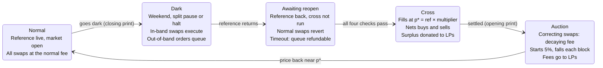
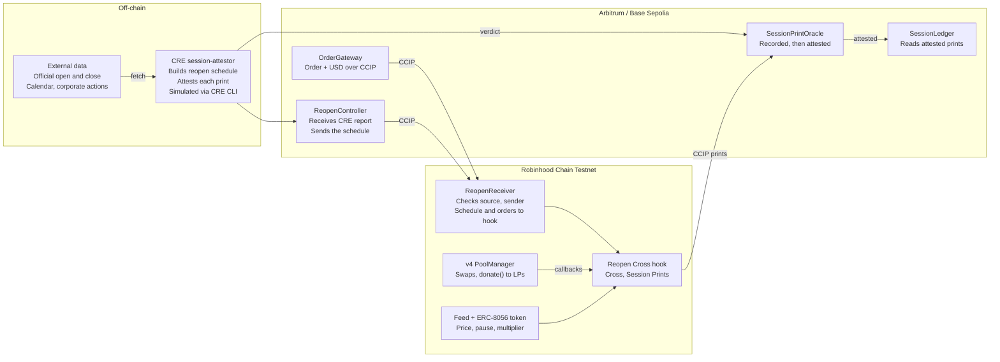

# Reopen Cross: Session Print — PRD

Nov 5, 2026 · @Narayanan

## Summary

Reopen Cross is a Uniswap v4 hook for Robinhood stock-token pools that makes the market open fair and turns it into a price other products can settle on. While the reference is dark it queues large trades; at the open it clears them in one uniform-price cross, records that price as a split-safe **Session Print**, has a CRE workflow attest it against the official exchange open, and broadcasts it to other chains over CCIP.

Pitch line: "Most of a stock's return arrives at the open. We make the open fair for LPs, and we turn it into a split-safe price any chain can settle on."

| Track | Prize | What qualifies the project |
| --- | --- | --- |
| Uniswap (ETHGlobal Mumbai) | Amount to confirm at the venue | A v4 hook with an async queue, a uniform-price cross, `donate()` to LPs, a dynamic-fee auction, and a Session Print at every open and close |
| [Chainlink: Best use of CCIP 2.0](https://ethglobal.com/events/mumbai/prizes/chainlink) | $3,500, up to 2 teams at $1,750 | The hook broadcasts Session Prints to `SessionPrintOracle` on Arbitrum and Base Sepolia; schedules and cross-chain orders flow in the other way |
| [Chainlink: Best workflow with CRE](https://ethglobal.com/events/mumbai/prizes/chainlink) | $1,500 | The `session-attestor` workflow checks each print against the official open or close from a market-data API and writes the verdict on-chain; it also builds the reopen schedule |

Target chains: Robinhood Chain Testnet (chain id 46630) for the hook, Arbitrum Sepolia and Base Sepolia for the print oracle and CCIP senders, and an Anvil fork of Robinhood Chain mainnet (chain id 4663) for the replay demo.

## Problem

Tokenized stocks trade 24/7, but their value arrives in jumps at session boundaries, and two things break at every reopen: LPs pay for the jump, and nothing on-chain records a fair, split-safe open price.

| Evidence | Figure | Source |
| --- | --- | --- |
| Share of SPY's long-run gain earned from close to open | 97.6% (Jan 1993 to Nov 2025) | The Standard Reserve, *Isolated Exposure Tokens* (Oct 2026), quoting third-party analyses; the paper says it did not recompute them |
| Reserve-owned pools' share of stock-token volume on Robinhood Chain | 24% overall, 56% on weekends | [The Standard Reserve on X](https://x.com/standard_rsv/status/2118336446461587545), Nov 5, 2026, self-reported |
| Uniswap v4 share of stock-token DEX liquidity on Robinhood Chain | About 73% | [Crypto Briefing](https://cryptobriefing.com/uniswap-v4-dominates-robinhood-chain-tokenized-stocks/) |

So most of a stock's movement lands at the open, and most stock-token flow trades while the reference is dark.

| Dark period | What happens to the reference | What happens to the pool today |
| --- | --- | --- |
| Weekend and overnight close | Frozen at the last close | Trades at a stale price; the first bot at the open takes the gap from LPs |
| Corporate-action pause (split) | Oracle paused until Robinhood confirms the new multiplier | Keeps trading; Robinhood pauses its own app, but nothing pauses third-party pools |
| Trading halt or feed outage | Stale, with no schedule | Keeps trading blind |

Four harms, using the illustrative 1,000 STOCK / 200,000 USDG pool from this PRD:

1. **Reopen arbitrage.** On a 6% weekend move ($200 to $212), the first arbitrageur earns about $175.60 from LPs.
2. **Split timing mismatch.** On a 2-for-1 split at the open, the share prints at $106 before the multiplier updates. A naive reader prices a $212 token at $106.
3. **Stale weekend fills.** Weekend traders fill at Friday's price, paid for by LPs.
4. **No settlement price.** Session products, such as the Reserve's proposed overnight and session tokens, settle each day on the official open and close (overnight = open minus prior close). Today they must trust a single oracle print with no trades behind it, and a per-share print taken before the multiplier updates on a split day records a fake 50% overnight loss.

What is not the problem: reserves never need repricing. Robinhood tokens keep raw balances and expose a `uiMultiplier()`, so the token price stays continuous through splits and dividends.

Prior art: the Reserve says it runs dynamic-fee v4 hooks that tighten spreads on these pools. Fees reduce the loss but keep the race at the open. Reopen Cross replaces the race with one cross, and does not build the Reserve's token design; it provides the print such tokens settle on.

## Goals, non-goals and success metrics

The hackathon build must prove two claims: LPs keep the reopen gap with no wrong-price fills, and every open and close yields an attested, split-safe price that another chain can read.

**Goals**

1. Treat weekend closes, corporate-action pauses and halts as one "dark reference" state: trade inside the band, queue everything else.
2. Reopen only when four on-chain checks pass, then clear the whole queue in one cross before any other swap.
3. Return the cross surplus and most of the leftover gap to LPs.
4. Record a Session Print at every close (last checked price before dark) and every open (the cross price), multiplier-adjusted.
5. Have CRE attest each print against the official exchange open or close; a disputed print is flagged, never silently used.
6. Broadcast prints to other chains over CCIP, and accept schedules and cross-chain orders over CCIP.
7. Show one consumer: a minimal overnight/session ledger that settles from attested prints.

**Non-goals**

- Repricing pool reserves for splits or dividends (not needed).
- Building the Reserve's Isolated Exposure Tokens as a product.
- Replacing the exchange's official price: a Session Print is an on-chain market price checked against it.
- Production security, audits or mainnet funds.

**Success metrics** (targets for the replay and testnet demo)

| Metric | Target | How it is measured |
| --- | --- | --- |
| Share of reopen gap kept by LPs | 80% or more, against 0% with no hook | Fork replay of the June 26, 2026 split weekend, three pools side by side |
| Wrong-price fills during the split mismatch | 0 | Replay asserts no fill while `oraclePaused()` is true or the multiplier is unchanged |
| Split-day opening print | Continuous in token terms (no fake 50% move) | Replay compares the print with the pre-split close |
| Swaps before the cross settles | 0 | Foundry test: any swap in the reopening state reverts |
| Print broadcast | Each print arrives on Arbitrum Sepolia and Base Sepolia | CCIP Explorer message IDs in the README |
| Print attestation | Every received print gets an Attested or Disputed verdict from one CRE run | `cre workflow simulate` output and the resulting transaction |

## Users and user stories

LPs and session-product builders are the two primary users: one needs the open to be fair, the other needs a price for it.

| User | Wants | Story |
| --- | --- | --- |
| Liquidity provider (including large owners like the Reserve) | Not to fund the reopen gap | As an LP, I want large trades to wait while the reference is dark, so the first bot at the open cannot take my liquidity at Friday's price. |
| Session-product builder | A trustworthy open and close | As a builder of overnight/session tokens, I want an attested, split-safe open and close per token per day on my chain, so I can settle without running my own oracle. |
| Weekend trader | A fair fill or a full refund | As a trader, I want to place a limit order on Saturday and have it fill at the reopen price, or get my money back. |
| Cross-chain trader | To join without bridging first | As a trader on Arbitrum or Base, I want to send USD and an order in one CCIP transaction and receive my fill on Robinhood Chain. |
| Small trader | Normal swaps on weekends | As a small trader, I want trades inside the ±2% band to execute normally. |
| Keeper or arbitrageur | A clear, fair trigger | As a keeper, I want to call the cross the moment all checks pass, and close the leftover gap through a public auction. |

## Solution overview

The hook is a five-state machine, and two of its transitions now publish a price: entering Dark records the closing print, and the Cross records the opening print.



Only the four on-chain checks move the pool out of Awaiting reopen: market in regular session; `oraclePaused()` false; feed fresh; new price within the plausibility range of the pre-dark price, with the multiplier updated if a split was scheduled. A CCIP schedule can move the pool into Dark early, never out.

**Session Print lifecycle**

1. **Recorded** on Robinhood Chain by the hook: token, session id, open or close, token price, multiplier, cross volume, timestamp.
2. **Broadcast** over CCIP to `SessionPrintOracle` on Arbitrum Sepolia and Base Sepolia.
3. **Attested or Disputed** by the CRE workflow, which compares the print with the official exchange price, split-adjusted. CRE can only judge a print, never change it.
4. **Consumed**: products read `getAttestedPrint(token, sessionId, kind)`, which reverts for prints that are not attested.

Why the cross makes a better open than a single oracle print: it is backed by real queued orders, it cannot run before the unpause and multiplier update, and its price is checked against Chainlink before it is recorded.

## Functional requirements

P0 items are the minimum to qualify for all three prizes; P1 makes the demo strong; P2 is stretch.

| ID | Requirement | Priority |
| --- | --- | --- |
| **Dark-mode detection** | | |
| F1 | The hook enters dark mode when any of these holds: market status is closed, `oraclePaused()` is true, or the feed is older than the staleness limit. | P0 |
| F2 | A schedule received over CCIP can enter dark mode early (for an announced split), but never exit it. Exit depends only on on-chain checks. | P0 |
| **Band and queue** | | |
| F3 | In dark mode, `beforeSwap` lets a swap execute only if its post-trade price stays within ±2% of the last reference (configurable). | P0 |
| F4 | A swap that would leave the band is queued instead: the hook takes the input through custom accounting, records the order (side, size, limit price, owner, source chain) and mints an ERC-6909 claim. | P0 |
| F5 | The queue is capped (default 50 orders per pool) so one cross fits in one transaction. Orders past the cap revert. | P0 |
| F6 | A queued order can be cancelled for a full refund until the cross starts. | P1 |
| **Reopen checks** | | |
| F7 | The cross can run only when all four pass: market in regular session; `oraclePaused()` false; feed fresh; reference × new multiplier within the plausibility range (default ±20%) of the pre-dark price. | P0 |
| F8 | Once dark mode has ended but the cross has not run, every normal swap reverts (ordering guard). | P0 |
| F9 | If the checks still fail after the timeout (default 24 hours past the scheduled reopen), all queued orders become refundable. | P1 |
| **Cross** | | |
| F10 | `executeCross()` is permissionless. It sets p\* = reference × multiplier, fills every order whose limit crosses p\*, and refunds the rest. | P0 |
| F11 | Buys and sells are netted against each other first; only the net imbalance trades against the pool. | P0 |
| F12 | The difference between what fillers paid at p\* and what the pool leg cost goes to LPs through `PoolManager.donate()`. | P0 |
| F13 | Fills for orders that came over CCIP are held as claims on Robinhood Chain, with an option to send them back over CCIP (F21). | P1 |
| **Leftover gap auction** | | |
| F14 | After the cross, swaps that move the price toward p\* pay a dynamic fee that starts at 5% and falls each block; swaps away from p\* pay the normal fee. Modelled on Uniswap's StablePair Hook, credited in the README. | P1 |
| F15 | Normal mode resumes when the pool price is within the band of p\*. | P1 |
| **Configuration and events** | | |
| F16 | Band, plausibility range, queue cap, timeout and feed addresses are set once in `beforeInitialize` hook data. | P0 |
| F17 | The hook emits events for every state change, queued order, fill, refund and donation, for the frontend and the replay. | P0 |

**Session Print requirements**

| ID | Requirement | Priority |
| --- | --- | --- |
| F22 | On entering Dark, the hook records a closing print: the last fresh reference price, in token terms, with the multiplier and timestamp. | P0 |
| F23 | On a successful cross, the hook records an opening print at p\*, with filled volume and order count. | P0 |
| F24 | Prints store the token price (multiplier-adjusted) and the multiplier, so consumers can derive the per-share price. | P0 |
| F25 | If the cross runs with no queued orders, the opening print is the first checked reference after unpause, flagged as having no cross volume. | P1 |
| F26 | Each print is sent over CCIP to every registered `SessionPrintOracle`, through a separate `PrintBroadcaster` contract so the hook stays small. | P0 |
| F27 | `SessionPrintOracle` stores prints as Recorded; a CRE report moves each to Attested or Disputed; duplicates and unknown senders are rejected. | P0 |
| F28 | Reference consumer `SessionLedger` keeps overnight (open minus prior close) and session (close minus open) dollar sums per share from attested prints. | P1 |

## Chainlink integration

Chainlink does three jobs, and one trust rule ties them together: feeds set the price, CRE can only attest or dispute it, and CCIP only carries it.

### 1. Data Feeds and Data Streams (on-chain checks)

Robinhood Chain launched with CCIP, Data Streams and Data Feeds live from day one ([Genfinity](https://genfinity.io/2026/08/27/cbbtc-robinhood-chain-chainlink-ccip-expansion/)). The hook reads the multiplier-adjusted stock-token feed for price and staleness, market status from Data Streams, and `oraclePaused()` and `uiMultiplier()` from the ERC-8056 token. These power the reopen checks and every Session Print.

### 2. CRE workflow: `session-attestor` (Best workflow with CRE)

One workflow, two handlers. Both write to Arbitrum Sepolia, because the [CRE supported-networks page](https://docs.chain.link/cre/supported-networks-ts) lists Arbitrum Sepolia but did not show Robinhood Chain when checked.

| Handler | Trigger | External data | On-chain write |
| --- | --- | --- | --- |
| Attest print | EVM log trigger on `PrintReceived` at `SessionPrintOracle` | Official open or close from a market-data API, fetched by each DON node and agreed by median; corporate-action and multiplier data | Report with session key, verdict and deviation in bps to `SessionPrintOracle.onReport()` |
| Build schedule | Cron, every 5 minutes | Exchange calendar (holidays, early closes) and pending multiplier changes | Report to `ReopenController.onReport()`, which forwards the schedule over CCIP |

Replay protection follows the [CRE consumer-contract guide](https://docs.chain.link/cre/guides/workflow/using-evm-client/onchain-write/building-consumer-contracts): each report carries the target chain selector, and a print can be judged only once. For the prize, `cre workflow simulate --broadcast` against the Arbitrum Sepolia mock forwarder is enough.

### 3. CCIP 2.0 (Best use of CCIP 2.0)

The Robinhood Chain Testnet has CCIP 2.0.0 lanes to Arbitrum Sepolia, Base Sepolia and Ethereum Sepolia, among others ([CCIP Directory](https://docs.chain.link/ccip/directory/testnet/chain/robinhood-testnet)). Router `0x30D197C6F5bE050D5525dD94d01760FaCdB67e7C`, chain selector `2032988798112970440`.

| ID | CCIP flow | Message type | State change | Priority |
| --- | --- | --- | --- | --- |
| F26 | Print broadcast: `PrintBroadcaster` (Robinhood) → `SessionPrintOracle` (Arbitrum and Base Sepolia) | Arbitrary message | Stores the print as Recorded on each destination chain | P0 |
| F18 | Schedule: `ReopenController` (Arbitrum Sepolia) → `ReopenReceiver` | Arbitrary message | Writes the next dark window and expected multiplier; can enter dark mode early | P0 |
| F19 | Cross-chain order: `OrderGateway` (Base or Arbitrum Sepolia) → `ReopenReceiver` | Programmable token transfer (quote token + order data) | Enqueues the order and mints its claim | P1 |
| F20 | Refund on failure: if an incoming order cannot be queued (cap reached, wrong state), the tokens are held as a refundable claim | Same message | Refundable claim | P1 |
| F21 | Fill delivery: a filled cross-chain order is sent back to the user's source chain | Token transfer | Claim burned | P2 |

The print broadcast is now the P0 CCIP flow, because other chains depend on it. Every receiver checks the source chain selector and sender address.

## Architecture, contracts and chains

The hook on Robinhood Chain sets every price; contracts on Arbitrum and Base Sepolia receive, judge and use those prices.



CRE writes only to Arbitrum Sepolia, so CCIP makes every hop into and out of Robinhood Chain. The hook reads the feed and token directly at cross time.

| Component | Chain | Role | Track |
| --- | --- | --- | --- |
| `ReopenCrossHook` | Robinhood Chain Testnet, plus a mainnet fork for the replay | v4 hook: dark mode, queue, cross, auction, Session Prints | Uniswap |
| `PrintBroadcaster` | Robinhood Chain Testnet | Sends each print over CCIP; holds the fee balance | CCIP |
| `ReopenReceiver` | Robinhood Chain Testnet | CCIP receiver for schedules and orders | CCIP |
| `SessionPrintOracle` | Arbitrum Sepolia, Base Sepolia | CCIP receiver for prints and CRE consumer for verdicts | CCIP, CRE |
| `ReopenController` | Arbitrum Sepolia | CRE consumer for the schedule and CCIP sender | CRE, CCIP |
| `OrderGateway` | Arbitrum Sepolia, Base Sepolia | CCIP sender for order data plus tokens | CCIP |
| `SessionLedger` | Arbitrum Sepolia | Reference consumer: overnight and session sums from attested prints | CCIP |
| `session-attestor` | CRE (TypeScript SDK) | Attests prints and builds the schedule | CRE |
| Frontend | Browser | Landing page, status, queue, orders, prints, LP panel | All |

Stack: Foundry, `v4-core` and `v4-periphery`, OpenZeppelin `uniswap-hooks`, Chainlink CCIP contracts and the CCIP Local Simulator, CRE CLI with the TypeScript SDK and viem, Next.js.

## Code snippets

These are starting sketches for the five core pieces, not compiled code. Before building, check import paths and signatures against the current `v4-core`, OpenZeppelin `uniswap-hooks`, CCIP 2.0 and CRE TypeScript SDK releases.

### 1. Hook permissions and `beforeSwap` (dark mode, band, queue)

The pool must be created with a dynamic fee so the hook can override it. Queueing uses the async-swap pattern: the hook takes the exact input as ERC-6909 claims and records the order.

```solidity
// SPDX-License-Identifier: MIT
pragma solidity ^0.8.26;

import {BaseHook} from "@openzeppelin/uniswap-hooks/src/base/BaseHook.sol";
import {Hooks} from "@uniswap/v4-core/src/libraries/Hooks.sol";
import {IPoolManager} from "@uniswap/v4-core/src/interfaces/IPoolManager.sol";
import {PoolKey} from "@uniswap/v4-core/src/types/PoolKey.sol";
import {PoolId, PoolIdLibrary} from "@uniswap/v4-core/src/types/PoolId.sol";
import {SwapParams} from "@uniswap/v4-core/src/types/PoolOperation.sol";
import {BeforeSwapDelta, BeforeSwapDeltaLibrary, toBeforeSwapDelta} from "@uniswap/v4-core/src/types/BeforeSwapDelta.sol";
import {LPFeeLibrary} from "@uniswap/v4-core/src/libraries/LPFeeLibrary.sol";

contract ReopenCrossHook is BaseHook {
    using PoolIdLibrary for PoolKey;

    enum Mode { Normal, Dark, AwaitingReopen, Auction }

    struct PoolState {
        Mode mode;
        uint256 darkRefPrice;      // token price (18 dp) when the pool went dark
        uint256 expectedMultiplier; // from the CCIP schedule; 0 if no corporate action
        uint64 sessionId;
    }

    mapping(PoolId => PoolState) public pools;

    error CrossPending();

    constructor(IPoolManager pm) BaseHook(pm) {}

    function getHookPermissions() public pure override returns (Hooks.Permissions memory p) {
        p.beforeInitialize = true;      // read config from hook data
        p.beforeSwap = true;
        p.beforeSwapReturnDelta = true; // lets the hook take input for queued orders
    }

    function _beforeSwap(address, PoolKey calldata key, SwapParams calldata params, bytes calldata hookData)
        internal
        override
        returns (bytes4, BeforeSwapDelta, uint24)
    {
        PoolState storage s = pools[key.toId()];
        _syncMode(key, s); // Normal -> Dark on close, oracle pause or stale feed; records the closing print

        if (s.mode == Mode.AwaitingReopen) revert CrossPending(); // ordering guard (F8)

        if (s.mode == Mode.Dark && !_staysInBand(key, params, s.darkRefPrice)) {
            // F4: exact-input only. Take the input as claims, store owner and limit from hookData.
            int128 taken = _queue(key, params, hookData);
            return (this.beforeSwap.selector, toBeforeSwapDelta(taken, 0), 0);
        }

        uint24 fee = s.mode == Mode.Auction ? _auctionFee(key, params) : _normalFee(key);
        return (this.beforeSwap.selector, BeforeSwapDeltaLibrary.ZERO_DELTA, fee | LPFeeLibrary.OVERRIDE_FEE_FLAG);
    }
}
```

### 2. Reopen checks, the cross and the opening print

```solidity
interface IERC8056 {
    function oraclePaused() external view returns (bool);
    function uiMultiplier() external view returns (uint256);
}

error MarketClosed();
error OraclePaused();
error StaleFeed();
error MultiplierNotUpdated();
error ImplausibleJump();
error NotAwaiting();

function executeCross(PoolKey calldata key) external {
    PoolState storage s = pools[key.toId()];
    if (s.mode != Mode.AwaitingReopen) revert NotAwaiting();

    uint256 pStar = _checkedReopenPrice(key, s);      // F7: all four checks or revert
    (uint256 volume, uint256 orders) = _settleCross(key, pStar); // unlock: fill, net, pool leg, donate()

    _recordPrint(key, s, PrintKind.Open, pStar, volume, orders); // F23
    s.mode = Mode.Auction;
}

function _checkedReopenPrice(PoolKey calldata key, PoolState storage s) internal view returns (uint256 p) {
    Config memory c = configs[key.toId()];

    if (!_marketOpen(c)) revert MarketClosed();                 // Data Streams market status
    if (IERC8056(c.stockToken).oraclePaused()) revert OraclePaused(); // advisory, so not the only guard

    (, int256 answer,, uint256 updatedAt,) = c.feed.latestRoundData();
    if (block.timestamp - updatedAt > c.maxStaleness) revert StaleFeed(); // primary guard

    if (s.expectedMultiplier != 0 && IERC8056(c.stockToken).uiMultiplier() != s.expectedMultiplier) {
        revert MultiplierNotUpdated(); // the split timing trap
    }

    p = uint256(answer) * 1e18 / (10 ** c.feed.decimals()); // multiplier-adjusted token price
    uint256 diff = p > s.darkRefPrice ? p - s.darkRefPrice : s.darkRefPrice - p;
    if (diff * 10_000 / s.darkRefPrice > c.plausibilityBps) revert ImplausibleJump();
}
```

### 3. Session Print and the CCIP broadcast

The hook hands each print to `PrintBroadcaster`, which pays CCIP fees in native ETH and sends one message per destination.

```solidity
import {IRouterClient} from "@chainlink/contracts-ccip/contracts/interfaces/IRouterClient.sol";
import {Client} from "@chainlink/contracts-ccip/contracts/libraries/Client.sol";

struct SessionPrint {
    address token;
    uint64 sessionId;
    uint8 kind;           // 0 = close, 1 = open
    uint256 tokenPrice;   // 18 dp, multiplier-adjusted
    uint256 multiplier;   // uiMultiplier() at print time
    uint256 crossVolume;  // 0 for closes and empty crosses
    uint64 timestamp;
}

contract PrintBroadcaster {
    struct Dest { uint64 selector; address oracle; }

    IRouterClient public immutable router;
    address public immutable hook;
    Dest[] public dests; // Arbitrum Sepolia and Base Sepolia

    constructor(address _router, address _hook, Dest[] memory _dests) {
        router = IRouterClient(_router);
        hook = _hook;
        for (uint256 i; i < _dests.length; ++i) dests.push(_dests[i]);
    }

    function broadcast(SessionPrint calldata p) external {
        require(msg.sender == hook, "only hook");
        bytes memory data = abi.encode(p);
        for (uint256 i; i < dests.length; ++i) {
            Client.EVM2AnyMessage memory m = Client.EVM2AnyMessage({
                receiver: abi.encode(dests[i].oracle),
                data: data,
                tokenAmounts: new Client.EVMTokenAmount[](0),
                extraArgs: Client._argsToBytes(
                    Client.GenericExtraArgsV2({gasLimit: 300_000, allowOutOfOrderExecution: true})
                ),
                feeToken: address(0) // pay in native ETH
            });
            uint256 fee = router.getFee(dests[i].selector, m);
            router.ccipSend{value: fee}(dests[i].selector, m);
        }
    }

    receive() external payable {}
}
```

### 4. `SessionPrintOracle`: CCIP receiver and CRE consumer

`ReceiverTemplate` is the abstract contract from the CRE consumer-contract guide; it checks the forwarder and calls `_processReport`.

```solidity
import {CCIPReceiver} from "@chainlink/contracts-ccip/contracts/applications/CCIPReceiver.sol";
import {Client} from "@chainlink/contracts-ccip/contracts/libraries/Client.sol";
import {ReceiverTemplate} from "./ReceiverTemplate.sol";

contract SessionPrintOracle is CCIPReceiver, ReceiverTemplate {
    enum Status { None, Recorded, Attested, Disputed }
    struct Entry { SessionPrint print; Status status; int32 deviationBps; }

    uint64 public immutable sourceSelector;  // Robinhood Chain Testnet: 2032988798112970440
    address public immutable broadcaster;
    uint64 public immutable selfSelector;    // this chain, for CRE replay protection
    mapping(bytes32 => Entry) public entries;

    event PrintReceived(bytes32 indexed key, address token, uint64 sessionId, uint8 kind, uint256 tokenPrice);
    event PrintJudged(bytes32 indexed key, bool attested, int32 deviationBps);

    constructor(address router, address forwarder, uint64 src, address _broadcaster, uint64 self)
        CCIPReceiver(router) ReceiverTemplate(forwarder)
    {
        sourceSelector = src; broadcaster = _broadcaster; selfSelector = self;
    }

    // CCIP: a print arrives from Robinhood Chain (F26, F27)
    function _ccipReceive(Client.Any2EVMMessage memory m) internal override {
        require(m.sourceChainSelector == sourceSelector, "source");
        require(abi.decode(m.sender, (address)) == broadcaster, "sender");
        SessionPrint memory p = abi.decode(m.data, (SessionPrint));
        bytes32 key = keccak256(abi.encode(p.token, p.sessionId, p.kind));
        require(entries[key].status == Status.None, "duplicate");
        entries[key] = Entry(p, Status.Recorded, 0);
        emit PrintReceived(key, p.token, p.sessionId, p.kind, p.tokenPrice); // CRE log trigger
    }

    // CRE: verdict on a recorded print
    function _processReport(bytes calldata report) internal override {
        (bytes32 key, bool ok, int32 devBps, uint64 chainSel) = abi.decode(report, (bytes32, bool, int32, uint64));
        require(chainSel == selfSelector, "wrong chain");          // cross-chain replay
        require(entries[key].status == Status.Recorded, "judged"); // same-chain replay
        entries[key].status = ok ? Status.Attested : Status.Disputed;
        entries[key].deviationBps = devBps;
        emit PrintJudged(key, ok, devBps);
    }

    function getAttestedPrint(address token, uint64 sessionId, uint8 kind) external view returns (SessionPrint memory) {
        Entry storage e = entries[keccak256(abi.encode(token, sessionId, kind))];
        require(e.status == Status.Attested, "not attested");
        return e.print;
    }

    function supportsInterface(bytes4 id) public view override(CCIPReceiver, ReceiverTemplate) returns (bool) {
        return CCIPReceiver.supportsInterface(id) || ReceiverTemplate.supportsInterface(id);
    }
}
```

### 5. CRE workflow: `session-attestor` (TypeScript)

The pattern (cron or log trigger, `HTTPClient` with median consensus, `runtime.report`, `EVMClient.writeReport`) follows the CRE TypeScript getting-started guide. The log-trigger options and report helper names are the parts to check most carefully.

```typescript
import {
  CronCapability, HTTPClient, EVMClient, handler, consensusMedianAggregation,
  Runner, getNetwork, type Runtime, type NodeRuntime,
} from "@chainlink/cre-sdk"
import { encodeAbiParameters, parseAbiParameters, decodeEventLog } from "viem"
import { oracleAbi } from "./abi"

type Config = {
  schedule: string
  officialPriceApi: string        // returns the exchange's official open or close per share
  oracleAddress: `0x${string}`    // SessionPrintOracle on Arbitrum Sepolia
  chainName: string               // "ethereum-testnet-sepolia-arbitrum-1"
  selfSelector: bigint
  maxDeviationBps: number
}

const initWorkflow = (config: Config) => {
  const net = getNetwork({ chainFamily: "evm", chainSelectorName: config.chainName, isTestnet: true })!
  const evm = new EVMClient(net.chainSelector.selector)
  const cron = new CronCapability()
  return [
    handler(evm.logTrigger({ addresses: [config.oracleAddress] }), onPrintReceived), // PrintReceived
    handler(cron.trigger({ schedule: config.schedule }), onScheduleTick),
  ]
}

const onPrintReceived = (runtime: Runtime<Config>, log: any) => {
  const { args } = decodeEventLog({ abi: oracleAbi, data: log.data, topics: log.topics })
  const { key, token, sessionId, kind, tokenPrice } = args as any

  // Each DON node fetches the official per-share price; nodes agree on the median.
  const officialPerShare = runtime.runInNodeMode((node: NodeRuntime<Config>): bigint => {
    const http = new HTTPClient()
    const res = http.sendRequest(node, {
      url: `${node.config.officialPriceApi}?token=${token}&session=${sessionId}&kind=${kind}`,
      method: "GET",
    }).result()
    const body = JSON.parse(new TextDecoder().decode(res.body))
    return BigInt(Math.round(body.pricePerShare * 1e8)) // 8 dp
  }, consensusMedianAggregation())().result()

  // Split-adjust: token price = per-share price x multiplier (multiplier read from the print).
  const multiplier = (args as any).multiplier as bigint      // 18 dp
  const officialToken = officialPerShare * multiplier / 10n ** 8n // 18 dp
  const devBps = Number((tokenPrice - officialToken) * 10_000n / officialToken)
  const ok = Math.abs(devBps) <= runtime.config.maxDeviationBps

  const payload = encodeAbiParameters(
    parseAbiParameters("bytes32, bool, int32, uint64"),
    [key, ok, devBps, runtime.config.selfSelector],
  )
  const report = runtime.report({ encodedPayload: payload }).result() // check the helper name in the SDK
  const net = getNetwork({ chainFamily: "evm", chainSelectorName: runtime.config.chainName, isTestnet: true })!
  new EVMClient(net.chainSelector.selector)
    .writeReport(runtime, { receiver: runtime.config.oracleAddress, report })
    .result()
}

const onScheduleTick = (runtime: Runtime<Config>) => {
  // Fetch calendar and pending multiplier changes, then writeReport to ReopenController (same pattern).
}

export async function main() {
  const runner = await Runner.newRunner<Config>()
  await runner.run(initWorkflow)
}
```

Run it with `cre workflow simulate --broadcast`, pointing `SessionPrintOracle` at the Arbitrum Sepolia mock forwarder during simulation.

### 6. Foundry test: the split timing trap

```solidity
function test_splitMismatch_waitsForUnpauseAndMultiplier() public {
    _goDarkFriday(200e18);                        // close print at $200
    _queueBuy(alice, 10e18, 215e18);              // limit $215
    _scheduleSplit(2e18);                         // CCIP schedule: multiplier 1.0 -> 2.0

    vm.warp(MONDAY_1330_UTC);
    stock.setOraclePaused(true);
    vm.expectRevert(OraclePaused.selector);
    hook.executeCross(key);

    stock.setOraclePaused(false);                 // unpaused, multiplier still 1.0
    vm.expectRevert(MultiplierNotUpdated.selector);
    hook.executeCross(key);

    stock.setUiMultiplier(2e18);
    feed.setAnswer(212e8);                        // token feed after the split
    hook.executeCross(key);

    SessionPrint memory open = hook.lastPrint(key, 1);
    assertEq(open.tokenPrice, 212e18);            // continuous, no fake 50% drop
    assertEq(open.multiplier, 2e18);
}
```

## Frontend and demo

The demo wins on two pictures: the same split weekend replayed through three pools with LP loss bars side by side, and the resulting opening print arriving attested on another chain.

**Frontend (landing page plus app; Next.js, viem, React Three Fiber, GSAP ScrollTrigger, Framer Motion)**

- Landing hero: a Three.js scene of the pool as a field of glowing liquidity particles around a price line, with a headline and one "Launch app" button.
- Scroll story: as the user scrolls, GSAP ScrollTrigger moves the camera through four scenes. The market closes and the particles dim (Dark); orders gather as a queue; they snap together at one point (Cross); the line eases back to fair price (Auction).
- Section animations: headings and cards fade and slide in on scroll, the problem numbers count up, and the three-pool LP loss bars grow when they come into view.
- Status banner: Normal, Dark, Awaiting reopen, Cross, Auction, with the reason (weekend, split pause, halt).
- Countdown: "Cross scheduled: Mon 13:30 UTC", read from the CCIP-delivered schedule.
- Queue book: queued buys and sells with limit prices, and the clearing price once the cross runs.
- Place order: a local limit order, or a cross-chain order from Arbitrum or Base Sepolia with its CCIP message link.
- Reopen checks: four lights for session, unpause, freshness and plausibility.
- LP panel: surplus donated and auction fees earned.
- Interactive replay: a timeline scrubber for the June 26 split weekend with play and pause; the pool state, queue and LP loss update as the user drags it.
- Live feedback: the order form shows in real time whether a trade stays inside the band or will be queued; new queued orders slide into the book; the cross animates orders converging on p\*.
- Ease of use: a plain-language line under every state ("Market closed: big trades wait for Monday's open"), hover tooltips on each check, wallet connect in one click, and a layout that works on mobile.
- Performance and access: the 3D scene loads lazily with capped pixel ratio, and users with reduced motion turned on get a static hero and simple fades.
- Session Prints panel: each token's latest close and open, with its status moving from Recorded to Attested (or Disputed), the deviation from the official price, and the CCIP message link for each destination chain.

**Demo script (3 minutes)**

1. The problem in 20 seconds: most of a stock's return lands at the open, and the June 26, 2026 event on Robinhood Chain combined weekend news, a 2-for-1 split and the Monday open.
2. Replay on an Anvil fork of Robinhood Chain mainnet: no hook, a fee-only hook, and Reopen Cross through the same weekend.
3. Show the trap: at 13:30 the share prints at $106; Reopen Cross waits, while a naive reader would fill at half price.
4. Unpause: the cross fills Alice and Bob at $212, refunds Carol and donates $64.76 to LPs; the auction closes the rest.
5. The opening print: recorded at $212 with multiplier 2.0, sent over CCIP, and arriving on Arbitrum Sepolia as Recorded.
6. CRE: the `cre workflow simulate` run fetches the official open, split-adjusts it and marks the print Attested; `SessionLedger` books the overnight move.
7. The result bars: LP loss with each pool.

All dollar figures are from the illustrative x·y = k pool; the replay must replace them with real numbers before judging.

## Track qualification checklist

The CCIP rule is the strictest: CCIP must change state inside our contracts, and a frontend reading Data Feeds does not count.

**Chainlink: Best use of CCIP 2.0**

- [ ] `PrintBroadcaster` sends prints and `SessionPrintOracle` stores them on Arbitrum Sepolia and Base Sepolia (F26, F27).
- [ ] `ReopenReceiver` applies a schedule on Robinhood Chain Testnet (F18).
- [ ] CCIP Explorer links for at least one print and one schedule in the README; tested first with the CCIP Local Simulator.

**Chainlink: Best workflow with CRE**

- [ ] Workflow connects a blockchain with an external API (official prices, calendar, corporate actions).
- [ ] Successful `cre workflow simulate` output in the README, showing a print moving to Attested.
- [ ] Its output is used: only attested prints reach `SessionLedger`, and the schedule drives early dark mode.

**Uniswap**

- [ ] v4 hook deployed with passing Foundry tests, including the split-trap test.
- [ ] Read the Mumbai Uniswap prize page for its exact requirements (recent ETHGlobal Uniswap prizes asked for a documented repo, a demo video and a developer feedback form).
- [ ] StablePair Hook credited for the auction design.

**Submission**

- [ ] Public repo, README with architecture, addresses and tx links, and a 3-minute video.
- [ ] ETHGlobal limits how many sponsors a project can pick; this project uses two, Uniswap and Chainlink.

## Risks, open questions and build plan

The biggest risk is still time, so the build plan finishes the hook and the print broadcast before the queue extras.

| Risk | Impact | Mitigation |
| --- | --- | --- |
| Async queue and custom accounting bugs | Lost or stuck funds in the demo | Queue cap, full refund path, Foundry fuzz tests on settlement balances |
| Thin or empty cross makes a weak opening print | A print backed by little volume | Store volume and order count; flag empty crosses (F25); CRE disputes prints outside the deviation limit |
| No free source for the official open and close | CRE cannot attest | Pick the market-data API early; fall back to a mock API for the simulation and say so in the README |
| No Uniswap v4 deployment on Robinhood Chain Testnet | Hook cannot go live on testnet | Deploy our own v4-core PoolManager there; the replay uses the mainnet PoolManager `0x8366a39CC670B4001A1121B8F6A443A643e40951` on a fork |
| Robinhood's UniversalRouter is modified (extra `minHopPriceX36` field) | Standard SDK swap calldata reverts | Test router or direct PoolManager calls |
| CRE cannot write to Robinhood Chain | CRE output cannot reach the hook directly | Designed around: CRE writes to Arbitrum Sepolia, CCIP carries the rest |
| `oraclePaused()` is advisory, not enforced | A paused oracle may still return a value | Staleness, multiplier and plausibility checks are the primary guards |
| Reserve figures are self-reported | Judges question the evidence | Present them as "the Reserve reports", with links |

**Open questions**

- [ ] What does the Mumbai Uniswap prize require, and how much is it?
- [ ] Do Uniswap and Chainlink judges accept a Robinhood Chain Testnet deployment?
- [ ] Which API gives the official open and close per symbol, and does the CRE DON allow it?
- [ ] Is there a Chainlink feed for a stock token on Robinhood Chain Testnet, or do we mock it there and use the real one only in the fork?
- [ ] Should prints also go to Ethereum Sepolia, or are two destinations enough for the demo?

**Build plan (to submission on Nov 7)**

1. Hook core: dark mode, band, queue, ordering guard, reopen checks, closing and opening prints (F1 to F8, F22 to F24), with Foundry tests including the split trap.
2. Cross and `donate()` (F10 to F12), then the fork replay of the June 26 split weekend with three pools.
3. CCIP: `PrintBroadcaster` and `SessionPrintOracle`, tested in the CCIP Local Simulator, then live from Robinhood Chain Testnet to Arbitrum and Base Sepolia.
4. CRE: `session-attestor` attest handler with `cre workflow simulate --broadcast`; then the schedule handler and `ReopenReceiver`.
5. `SessionLedger`, cross-chain orders and the auction, as time allows.
6. Landing page and app, README with addresses and tx links, 3-minute video.

**Sources**

- [The Standard Reserve on X: King of the Markets results (Nov 5, 2026)](https://x.com/standard_rsv/status/2118336446461587545)
- The Standard Reserve, *Isolated Exposure Tokens: time-partitioned positions on tokenized equities* (Oct 2026), shared by the team
- [ETHGlobal Mumbai: Chainlink prizes](https://ethglobal.com/events/mumbai/prizes/chainlink)
- [Chainlink CCIP Directory: Robinhood Chain Testnet](https://docs.chain.link/ccip/directory/testnet/chain/robinhood-testnet)
- [Chainlink CRE: supported networks](https://docs.chain.link/cre/supported-networks-ts)
- [Chainlink CRE: building consumer contracts](https://docs.chain.link/cre/guides/workflow/using-evm-client/onchain-write/building-consumer-contracts)
- [Chainlink CRE: writing on-chain (TypeScript)](https://docs.chain.link/cre/getting-started/part-4-writing-onchain-ts)
- [Genfinity: cbBTC on Robinhood Chain via CCIP](https://genfinity.io/2026/08/27/cbbtc-robinhood-chain-chainlink-ccip-expansion/)
- [Crypto Briefing: Uniswap v4 share of Robinhood Chain stock liquidity](https://cryptobriefing.com/uniswap-v4-dominates-robinhood-chain-tokenized-stocks/)
- [RHCSwap: Robinhood Chain v4 addresses and router quirk](https://github.com/jumpboxtech/rhcswap)
