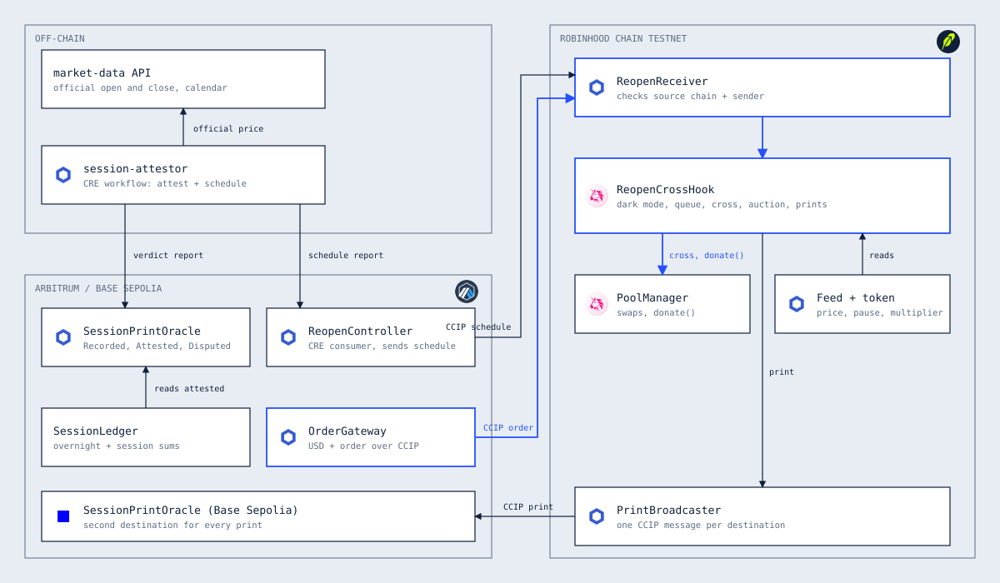
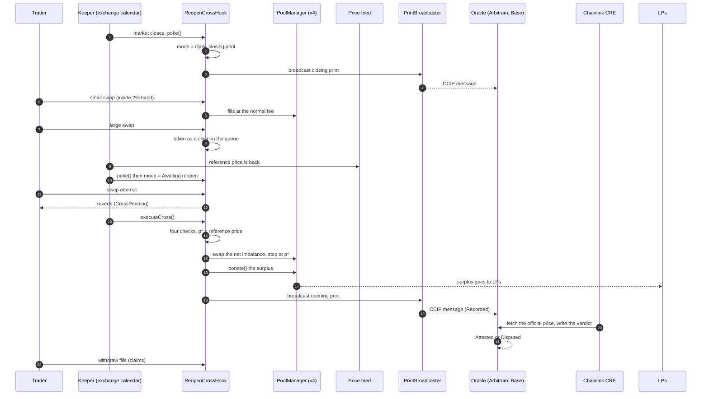
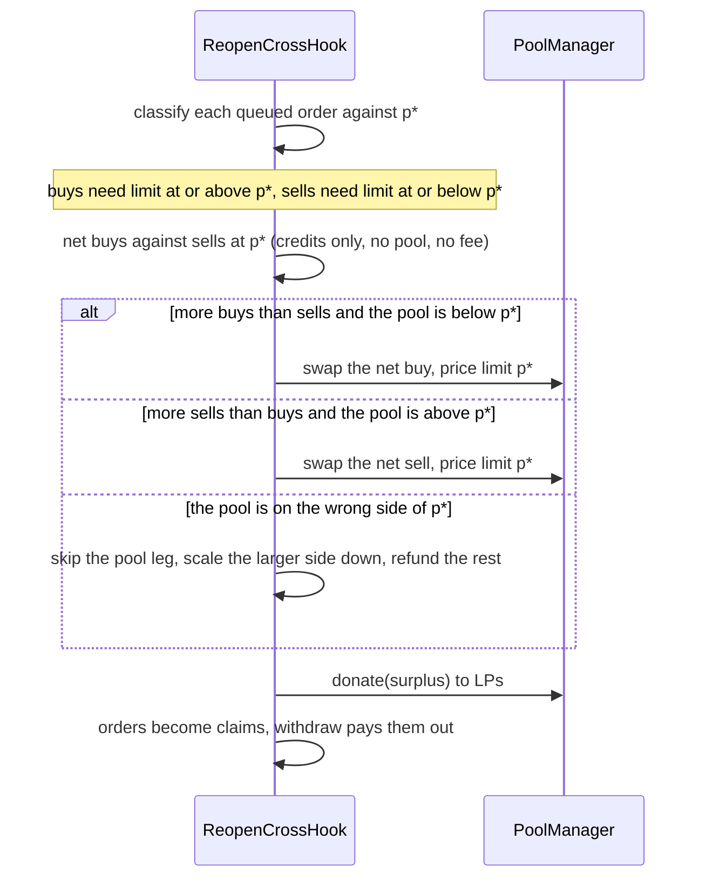

# Corvex: demo script and pitch

One fair price for every open. A Uniswap v4 hook for tokenized-stock pools, with a Chainlink CCIP and CRE layer.

Everything below runs today, on the live testnets or on a local chain.

## 1. Problem statement

Tokenized stocks trade on-chain all weekend. The price they track does not: the exchange is closed from Friday evening to Monday morning, and on holidays and halts.

Liquidity providers in a stock-token pool therefore sell into stale quotes. When news lands, the real price jumps at the open, and the first bot to arrive buys the whole gap from the pool at Friday's price. The LPs pay for it.

- 97.6% of SPY's long-run gain arrived between the close and the open (quoted from The Standard Reserve, not recomputed).
- Uniswap v4 holds about 73% of stock-token DEX liquidity on Robinhood Chain.
- The same thing happens when a stock splits and the oracle pauses: any price shown during the pause is wrong.

A plain fee hook does not fix this. It charges everyone a little more, so it hurts normal traders and still leaves a gap for the bot.

## 2. Proposed solution

Corvex is a Uniswap v4 hook that gives the pool three behaviours.

| When | What the pool does |
| --- | --- |
| Reference price is live | Normal trading at the normal fee. |
| Reference price is dark (weekend, holiday, split pause, stale feed) | Trades that keep the price inside a 2% band still fill. Bigger trades are taken as claims and queued. Nothing fills at a stale price outside the band. |
| Reference price returns | Swaps pause until anyone runs `executeCross`. It clears the whole queue at **one price**, matches buys against sells, swaps only the net against the pool (never past that price), and donates the surplus to LPs with `donate()`. A falling-fee auction then closes what is left of the gap. |

Every open and close is recorded as a **Session Print**. Chainlink CCIP carries each print to Arbitrum and Base, and a Chainlink CRE workflow checks it against the official exchange price and marks it Attested or Disputed.

## 3. Architecture



| Part | Chain | Job |
| --- | --- | --- |
| `ReopenCrossHook` | Robinhood Chain | Dark mode, the queue, the cross, `donate()`, the auction fee, prints. |
| `PrintBroadcaster` | Robinhood Chain | One CCIP message per destination for each print. A failed destination never blocks the hook. |
| `ReopenReceiver`, `FillVault` | Robinhood Chain | Receives cross-chain orders and schedules, and delivers fills back to the buyer's source chain. |
| `SessionPrintOracle` | Arbitrum, Base | Stores each print as Recorded, then Attested or Disputed. |
| `OrderGateway` | Arbitrum, Base | Sends USD plus an order in one CCIP message. |
| `ReopenController` | Arbitrum | Takes a CRE schedule report and forwards it to the hook over CCIP. |
| `SessionLedger` | Arbitrum | Books overnight and session moves from attested prints only. |
| CRE `session-attestor` | Chainlink DON | Cron plus log triggers: fetches the official price and calendar, writes the verdict. |
| Console (`web`) | Browser | Trade, Prints and Liquidity pages, plus the landing page and the replay. |

Data Feeds supply the reference price, staleness and plausibility. `MarketStatus` carries the exchange session; on testnet a keeper writes it, and in production it would be a Data Streams adapter.

## 4. Sequence diagrams

### One weekend



### Inside the cross



## 5. Where LPs get paid

LPs are paid in two ways, and only one of them shows up in the "Paid to LPs by crosses" figure.

1. **Cross surplus** (`donate()`): orders pay the cross price p*. The pool leg trades along the curve up to p*, so its average price is better than p*. The difference is donated. It shows up on the Liquidity page.
2. **Fees**: every swap pays the normal 0.3%, and during the auction, trades toward the cross price pay a fee that starts at 5% and falls every block. Fees accrue to the pool and show up in the pool's reserves, not in the crosses table.

**A surplus appears only when the net imbalance trades through the pool in the direction of the gap.**

| Reference against pool | The net must be | Result |
| --- | --- | --- |
| Reference above the pool (gap up) | Buys | The pool sells TSLA from the pool price up to p*. Surplus donated. |
| Reference below the pool (gap down) | Sells | The pool buys TSLA from the pool price down to p*. Surplus donated. |
| Reference above the pool | Sells (or buys equal sells) | The pool leg is skipped. Nothing for the pool to do, so no surplus. |
| No gap | Anything | No surplus. Fees only. |

### Why one test cross paid LPs nothing

Session 9 on the testnet queued two 3,000 USDG buys and two 15 TSLA sells, and reopened at $224 with the pool at $212.

- Buys total 6,000 USDG (26.79 TSLA at $224). Sells total 30 TSLA (6,720 USDG at $224). The net is a **sell**.
- The pool was below p*, so a sell would push the price further from $224. The pool leg is skipped by design, because it would trade past the cross price.
- The 6,000 USDG matched peer to peer at $224. The buys filled in full, and the sells filled 89.3% (Partial) with the unfilled 3.2 TSLA refunded.
- No pool trade means no surplus. The pool was left at $212.24 against a $224 reference, which is exactly what the **auction** is for: bots that buy TSLA toward $224 pay the falling fee to LPs.

### How to see LPs get paid (test recipe)

1. Reopen at $212 so the pool is Normal at about $212.
2. **Close market.**
3. Queue **two large buys** (the "3000 Large" button twice) and **no sells**.
4. Set the price to **224** and press **Reopen market**.
5. The net is a buy, so the pool leg runs from about $212 up to $224. The buyers pay $224 per TSLA and the pool sells below that on average. By estimate (from the pool's liquidity at about $212) that is roughly $150 to $170 of surplus, so the Liquidity page shows a TSLA amount in "Paid to LPs". Session 1 on the testnet is the same case: one 5,000 USDG buy, a reopen at $212 from $200, and 1.2881 TSLA donated to LPs.
6. The pool is now in Auction at about $224. A small buy while it runs shows the 5% falling fee.

The mirror case works too: reopen at a price below the pool with a net sell.

## 6. The three-minute video

| Time | On screen | Say |
| --- | --- | --- |
| 0:00 | Landing page hero | "Tokenized stocks trade all weekend. The price they track doesn't. LPs sell into stale quotes. Corvex fixes that." |
| 0:20 | The product card and "How a cross works" | "While the price is dark, big orders queue. When it returns, buys match sells at one price, only the net touches the pool, and the surplus goes to LPs." |
| 0:45 | Trade page, connect wallet | "This is Robinhood Chain Testnet, with a real v4 pool and a real hook." |
| 1:00 | Get test tokens, Close market | "The market closes. The pool goes dark. Nothing fills outside a 2% band." |
| 1:15 | Place a small buy, then the 3000 large buy and the 15 TSLA sell | "A small buy fills inside the band. The large ones queue. Queue status shows what matches and what goes to the pool." |
| 1:40 | Reopen market at 224 | "The market reopens. Anyone can run the cross. One price for the whole queue." |
| 1:55 | Queue shows Settled, claims appear, Withdraw | "Buys filled, sells filled, and here are the claims." |
| 2:10 | Liquidity page | "The surplus was donated to the pool. This is what an LP earns from the open." |
| 2:25 | Prints page, then the CRE simulate command | "Each open is recorded, sent over Chainlink CCIP to Arbitrum and Base, and a CRE workflow checks it against the official price." |
| 2:45 | Landing replay | "Same weekend through three pools. No hook loses 115. The fee-only baseline is illustrative. Corvex gives it back." |

## 7. Prepare

1. Start from a settled pool. In the Trade page, set Price to `212` and press **Reopen market**. If it shows Auction, make one small buy so it returns to Normal.
2. Fresh feed: **Close market** and **Reopen market** both stamp a fresh price. The mock feed goes stale after an hour, so do this just before recording.
3. App in live mode: `cd web`, `npm run dev`, open http://localhost:3000/app. The `web/.env` file holds the testnet settings.
4. Keeper: `contracts/.env` needs `PRIVATE_KEY` for the Close and Reopen buttons. They only answer on localhost.
5. CRE: in one terminal `node cre/mock-api/server.mjs`, in another `$env:MARKET_DATA_API_KEY_VAR = "mock-key"`.
6. A wallet with a little Robinhood Chain Testnet ETH. Connecting switches the network.

The CRE command for the attestation scene:

```
cre workflow simulate session-attestor --target staging-settings --non-interactive --broadcast --trigger-index 0 --evm-tx-hash <delivery tx> --evm-event-index 0
```

## 8. Step-by-step live test

1. **Connect wallet.** Click it, choose your account in MetaMask, approve adding Robinhood Chain Testnet (46630).
2. **Get test tokens.** Confirm two transactions: 50 TSLA and 10,000 USDG.
3. **Small buy.** Buy TSLA, "100 Small", Place order. Confirm the exact-amount approval, then the swap. It fills now and does not appear in the queue.
4. **Close market.** The banner turns Dark.
5. **Large buy and large sell.** "3000 Large" buy, then Sell TSLA "15 Large". Each shows "Queue order". Queue status shows 1 buy and 1 sell waiting.
6. **Reopen market.** Price 212 (or 224 for a gap). If it stops at Awaiting reopen, press **Run the cross**.
7. **Withdraw.** Your claims appear in the Queue tile. Withdraw each.
8. **Liquidity.** A new row for the session and the amount paid to LPs.
9. **Prints.** Arbitrum and Base show In transit, then Delivered after 15 to 30 minutes. Run the CRE command to make Arbitrum Attested.

## 9. What each prize wants to see

- **Uniswap:** a v4 hook (dynamic fee, `beforeSwap` return delta, `donate()`), the queue held as ERC-6909 claims, a public repo, `FEEDBACK.md`, and the feedback form.
- **Chainlink CRE:** the workflow combines a blockchain read with an external API and shows a successful simulation. The `--broadcast` run writes real attestations.
- **Chainlink CCIP:** state changes on another chain made by CCIP messages: prints recorded, schedules applied, orders queued.

## 10. Questions you may get

**What if a bot splits its trades into many small ones?** The 2% band is measured from the last reference price, not per trade, and constant-product price impact is path independent. A thousand small buys move the price as far as one big one, so the band stops them at the same point. Further trades at the edge queue and clear at p* like everyone else. The known weakness: there is no minimum queued order size and each session holds 50 open orders, so spam at the band edge could fill the queue. A minimum size and a per-owner cap are the planned fixes.

**Why did the sells fill partially at $224?** The pool was below p*, so the pool leg is skipped, and the larger side is scaled down to what the other side can absorb. The unfilled part is refunded.

**Where does the surplus come from?** From the pool leg trading along the curve to p*, so its average price is better than p*.

**Is this live?** It runs on Robinhood Chain Testnet, Arbitrum Sepolia and Base Sepolia with mock TSLA and USDG, a mock price feed and a keeper-written market status. Every step in the demo weekend is a real transaction. Robinhood's testnet has no v4, so the v4 PoolManager is deployed from the real v4-core.

**What is not built?** The fork replay of the real June 26 weekend (it needs a mainnet RPC), a CCIP token lane for the mock USDG (so cross-chain fills only come back locally), and the order-size limit above.

## 11. If something goes wrong on camera

- **The pool isn't dark:** press Close market again.
- **It is stuck in Auction:** one small buy returns it to Normal.
- **The feed is stale (Fresh feed is red):** press Reopen market at 212.
- **RPC is slow:** the console polls every few seconds. Give it a moment.
- **A print hasn't arrived:** show the CCIP explorer link for the weekend that already ran, listed on the Prints page.
